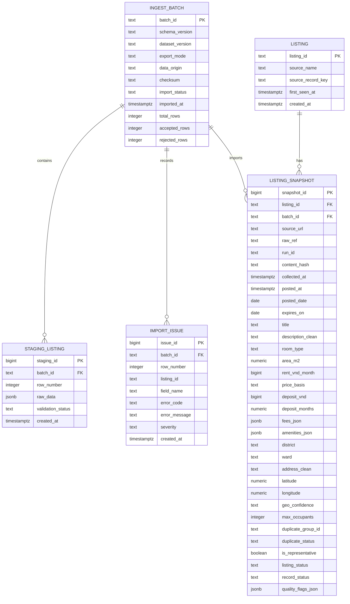

# THIẾT KẾ CƠ SỞ DỮ LIỆU - ERD

## 1. Thông tin chung

- Đề tài: Hệ thống phân tích thị trường phòng trọ hỗ trợ sinh viên lựa chọn nơi ở.
- Nhóm: 11 - 65HTTT.
- Người thực hiện: Trần Thị Minh Thư.
- Nhiệm vụ: TV2-02.
- Hệ quản trị cơ sở dữ liệu: PostgreSQL 16.
- Phiên bản thiết kế: 1.0.
- Trạng thái: Thiết kế dự thảo.

## 2. Mục tiêu thiết kế

- Lưu trữ dữ liệu tin đăng phòng trọ.
- Quản lý các đợt nhập dữ liệu.
- Kiểm tra và ghi nhận lỗi dữ liệu đầu vào.
- Đảm bảo tính toàn vẹn dữ liệu.
- Không tạo bản ghi trùng khi nhập lại dữ liệu.
- Lưu lịch sử thay đổi của tin đăng.
- Cung cấp dữ liệu cho Apache Superset.
- Tách biệt dữ liệu thực và dữ liệu kiểm thử.

## 3. Sơ đồ ERD

## 4. Mô tả các thực thể

### 4.1. INGEST_BATCH

Quản lý thông tin của từng đợt nhập dữ liệu.

Khóa chính: batch_id.

Thông tin quản lý:

- Phiên bản schema.
- Phiên bản bộ dữ liệu.
- Chế độ xuất dữ liệu full hoặc delta.
- Nguồn gốc dữ liệu real hoặc synthetic.
- Checksum của tệp dữ liệu.
- Trạng thái nhập dữ liệu.
- Tổng số dòng.
- Số dòng hợp lệ.
- Số dòng bị từ chối.

Trạng thái nhập dự kiến:

- pending: Chờ xử lý.
- processing: Đang xử lý.
- succeeded: Nhập thành công.
- failed: Nhập thất bại.

Chỉ dữ liệu thuộc batch succeeded mới được
sử dụng trong các view phục vụ dashboard.

### 4.2. STAGING_LISTING

Lưu dữ liệu CSV trước khi đưa vào các bảng chính.

Khóa chính: staging_id.

Khóa ngoại: batch_id tham chiếu INGEST_BATCH.

Dữ liệu từng dòng được lưu dưới dạng JSONB,
giúp truy xuất thông tin đầu vào khi kiểm tra lỗi.

Ràng buộc duy nhất:

- batch_id và row_number.

### 4.3. LISTING

Quản lý định danh ổn định của tin đăng phòng trọ.

Khóa chính: listing_id.

listing_id được xác định theo quy tắc:

source_name:source_record_key

Ràng buộc duy nhất:

- source_name và source_record_key.

Bảng này không lưu trực tiếp giá thuê hiện tại
nhằm tránh ghi đè lịch sử thay đổi.

### 4.4. LISTING_SNAPSHOT

Lưu các thuộc tính của tin đăng tại từng đợt dữ liệu.

Khóa chính: snapshot_id.

Khóa ngoại:

- listing_id tham chiếu LISTING.
- batch_id tham chiếu INGEST_BATCH.

Ràng buộc duy nhất:

- listing_id và batch_id.

Các thuộc tính bao gồm:

- Thông tin nguồn và thời gian quan sát.
- Thông tin phòng trọ.
- Giá thuê và diện tích.
- Tiền đặt cọc và các khoản phí.
- Tiện ích và vị trí.
- Trạng thái tin đăng.
- Thông tin chất lượng và trùng lặp.

Mỗi lần xuất hiện trong một batch mới,
tin đăng có thể được lưu thêm một snapshot.

### 4.5. IMPORT_ISSUE

Lưu các lỗi phát sinh trong quá trình nhập dữ liệu.

Khóa chính: issue_id.

Khóa ngoại: batch_id tham chiếu INGEST_BATCH.

Các lỗi dự kiến:

- INVALID_SCHEMA
- MISSING_REQUIRED_FIELD
- INVALID_DATA_TYPE
- INVALID_RENT
- INVALID_AREA
- INVALID_JSON
- DUPLICATE_LISTING_ID
- CHECKSUM_MISMATCH
- BATCH_CONFLICT

listing_id trong bảng lỗi có thể NULL hoặc
chứa định danh chưa hợp lệ từ dữ liệu đầu vào.

Không đặt khóa ngoại listing_id trong bảng này
vì lỗi có thể phát sinh trước khi tin được nhập
vào bảng LISTING.

## 5. Quan hệ giữa các bảng

| Bảng cha | Bảng con | Quan hệ |
|---|---|---|
| ingest_batch | staging_listing | 1-N |
| ingest_batch | import_issue | 1-N |
| ingest_batch | listing_snapshot | 1-N |
| listing | listing_snapshot | 1-N |

## 6. Ràng buộc toàn vẹn dữ liệu

- listing_id không được rỗng.
- source_name và source_record_key không được rỗng.
- collected_at phải có giá trị hợp lệ.
- rent_vnd_month lớn hơn 0 nếu có giá trị.
- area_m2 lớn hơn 0 nếu có giá trị.
- deposit_vnd không âm nếu có giá trị.
- deposit_months không âm nếu có giá trị.
- max_occupants lớn hơn 0 nếu có giá trị.
- price_basis thuộc room, person hoặc unknown.
- latitude nằm trong khoảng -90 đến 90.
- longitude nằm trong khoảng -180 đến 180.
- Không sử dụng tọa độ giả (0,0).
- fees_json phải là JSON object.
- amenities_json phải là JSON object.
- quality_flags_json phải là JSON array.
- Không chuyển giá trị chưa biết thành 0.
- Dữ liệu công bố phải đáp ứng hợp đồng dữ liệu TV1.

## 7. Quản lý lịch sử dữ liệu

Ví dụ dữ liệu giả lập:

| listing_id | batch_id | rent_vnd_month |
|---|---|---:|
| demo:001 | B001 | 3000000 |
| demo:001 | B002 | 3500000 |

Bảng LISTING chỉ có một bản ghi demo:001.

Bảng LISTING_SNAPSHOT có hai bản ghi
tương ứng với hai đợt dữ liệu.

View dữ liệu hiện tại lựa chọn snapshot phù hợp
theo thời gian quan sát và phạm vi batch công bố.

Không lựa chọn dữ liệu từ batch thất bại.

Đối với full export, cần xác định tập tin hiện tại
theo batch công bố và phạm vi dữ liệu tương ứng.

Đối với delta export, cần thống nhất quy tắc cập nhật
trước khi hỗ trợ nhập dữ liệu.

Không suy diễn tin biến mất là đã được cho thuê.

## 8. Các Analytics Views dự kiến

### vw_listing_current

Cung cấp dữ liệu tin đăng hiện tại.

Đảm bảo mỗi listing_id có tối đa một dòng
trong phạm vi dữ liệu được phân tích.

### vw_market_price

Cung cấp dữ liệu phục vụ phân tích giá thuê.

- Giá thuê hợp lệ.
- Đơn vị tính giá.
- Giá thuê trên m2.
- Khu vực.
- Loại phòng.
- Nguồn dữ liệu.

### vw_affordability

Cung cấp dữ liệu phân tích khả năng chi trả.

- Giá thuê.
- Đơn vị tính giá.
- Mức ngân sách.
- Tình trạng thông tin chi phí.
- Khu vực và loại phòng.

### vw_listing_quality

Cung cấp dữ liệu phân tích chất lượng.

- Thông tin giá bị thiếu.
- Thông tin diện tích bị thiếu.
- Thông tin phí bị thiếu.
- Độ tin cậy vị trí.
- Trạng thái trùng lặp.
- Độ mới của dữ liệu.
- Cờ chất lượng.

## 9. Phân quyền dự kiến

### Database Admin

- Quản lý schema và cấu trúc cơ sở dữ liệu.
- Quản lý tài khoản và phân quyền.
- Sao lưu và khôi phục.

### Importer

- Đọc dữ liệu phục vụ kiểm tra.
- Thêm và cập nhật dữ liệu nhập.
- Ghi nhận lỗi và trạng thái batch.

### BI Reader

- Chỉ đọc các view analytics được cấp quyền.
- Không sửa hoặc xóa dữ liệu nguồn.
- Không truy cập dữ liệu thô nếu không được cấp quyền.

## 10. Tiêu chí nghiệm thu

- Có sơ đồ ERD đầy đủ.
- Xác định khóa chính và khóa ngoại.
- Xác định quan hệ giữa các bảng.
- Có cơ chế lưu lịch sử.
- Có cơ chế kiểm soát nhập trùng.
- Có cơ chế ghi nhận lỗi nhập.
- Đảm bảo hỗ trợ ba dashboard BI.
- Có khả năng triển khai trên PostgreSQL.

## 11. Tài liệu tham chiếu

- data_contract.md
- ../ban_giao_tv1/dac_ta_du_lieu_v0_1.md
- ../../data/manifest.json
- Nhiệm vụ chi tiết TV2 - CSDL và BI.

## 12. Trạng thái triển khai

Đã xây dựng thiết kế ERD dự thảo.

Chưa triển khai các bảng trên PostgreSQL.
Các ràng buộc sẽ được kiểm chứng khi xây dựng
migration và thực hiện kiểm thử.